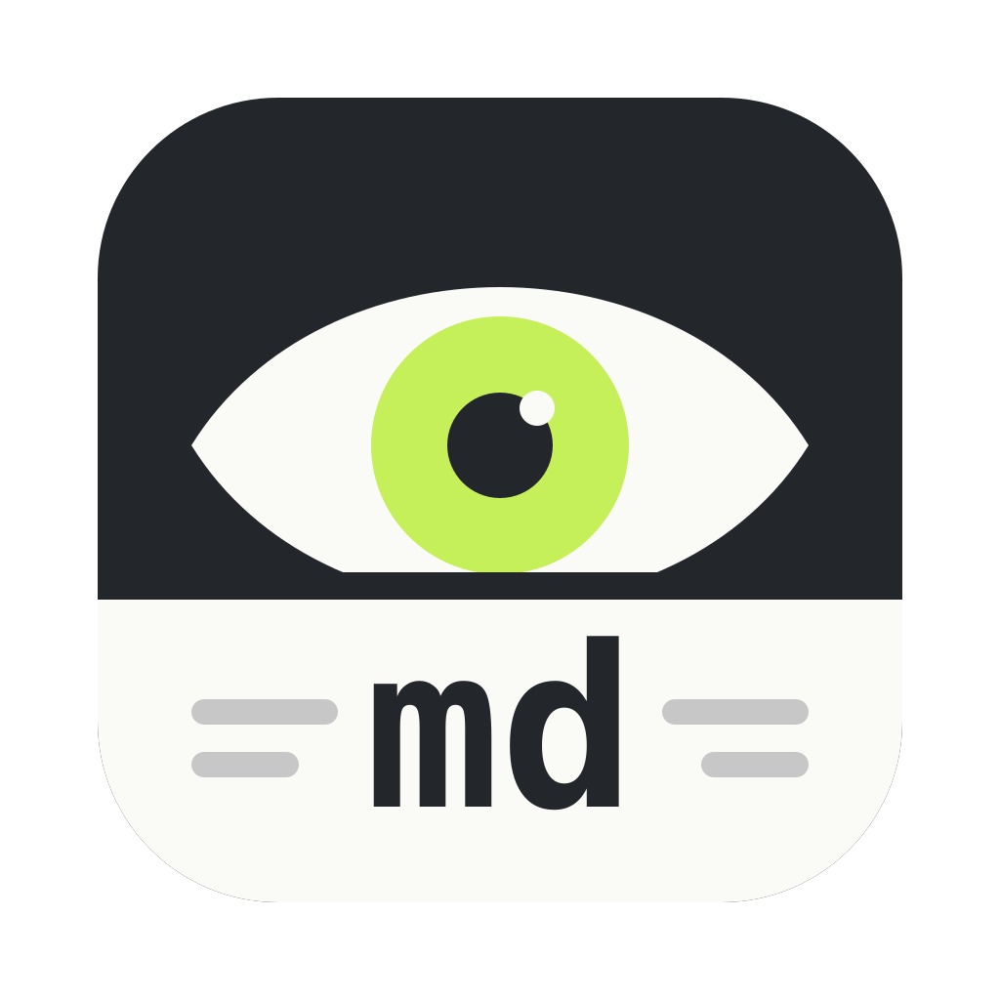

<p align="center">
  
</p>

<h1 align="center">Ogle</h1>

<p align="center"><b>Ogle at your Markdown files... with vim.</b></p>

- Markdown with Mermaid diagrams, syntax highlighting and alerts
- Neovim built in, with your own config, beside the preview
- Linked panes: the editor and the preview scroll and zoom together, or apart
- Reloads on save and highlights what changed
- Find with match counts, an outline sidebar, and Open Quickly for recent files
- Native macOS, light and dark

<p align="center">
  
</p>
<p align="center">
  
  
</p>

## Installation

### Download

Download `Ogle.zip` from the [latest release](https://github.com/hafenr/ogle/releases/latest) (Apple Silicon, macOS 15 or later), unzip it, and move `Ogle.app` to `~/Applications`. Releases are signed and notarized by Apple.

### Build from source

Requirements: macOS 15 or later, the Swift toolchain (Xcode, or the Command Line Tools via `xcode-select --install`), Node.js with npm, and curl (`build.sh` downloads the Neovim release it bundles).

1. Build the app from the project directory:

   ```sh
   ./build.sh          # produces build/Ogle.app
   ```

2. Install it and open it once, so macOS registers it for Finder's "Open With" and the command-line launcher:

   ```sh
   cp -R build/Ogle.app ~/Applications/
   open ~/Applications/Ogle.app
   ```

   Use `/Applications` instead to install it for all users.

3. Optionally, install the `ogle` command:

   ```sh
   mkdir -p ~/.local/bin
   ln -s "$PWD/bin/ogle" ~/.local/bin/ogle
   ```

   `~/.local/bin` must be on your `PATH` (e.g. add `export PATH="$HOME/.local/bin:$PATH"` to `~/.zshrc`). The command is a link into this checkout, so keep the checkout where it is.

4. Optionally, make Ogle the default app for Markdown files: select a `.md` file in Finder, choose File › Get Info (⌘I), pick Ogle under "Open with", and click Change All….

### Updating

Ogle checks for updates once a day and offers to install them; Ogle › Check for Updates… checks right away. Builds from source check too, and are offered the release that follows the commit they were built from.

To update a build from source by hand, quit Ogle, then rebuild and replace the installed app:

```sh
./build.sh && rm -rf ~/Applications/Ogle.app && cp -R build/Ogle.app ~/Applications/
```

### Uninstalling

```sh
rm -rf ~/Applications/Ogle.app ~/.local/bin/ogle
defaults delete dev.ogle    # recent files and window layout
```

### Releasing

Releases are built, signed and notarized on a Mac with the Developer ID certificate, and published with the [GitHub CLI](https://cli.github.com). Once, save notary credentials with `xcrun notarytool store-credentials ogle-notary` and log in with `gh auth login`. The key that signs updates is in the login keychain of the Mac that made it; to release from another Mac, export it with `.build/artifacts/sparkle/Sparkle/bin/generate_keys -x ogle-update-key` and import it there with `-f ogle-update-key`. Then, on an up-to-date `main` with everything committed:

```sh
scripts/release.sh          # shows the latest release and the next version
scripts/release.sh 0.3.3    # builds, signs, notarizes, then asks before tagging and publishing
```

## Usage

```sh
ogle README.md
```

Or use File › Open… (⌘O), drop a file on the Dock icon, or pick Ogle from Finder's "Open With". Zoom with ⌘+ / ⌘- / ⌘0 or pinch; pinching magnifies the preview only, and never changes the editor's text size, which follows ⌘+ / ⌘- / ⌘0 alone. Links to other Markdown files open in Ogle; other links open in the default app.

## Keyboard shortcuts

| Shortcut | Action |
| --- | --- |
| ⌘O / ⇧⌘O | Open… / Open Quickly… |
| ⇧⌘W | Close the file and go back to the start page |
| ⌘F, ⌘G / ⇧⌘G | Find, next / previous match |
| ⌃⌘E | Show or hide the editor |
| ⌃⌘S | Show or hide the sidebar |
| ⌘+ / ⌘− / ⌘0 | Zoom in / out / actual size |
| ⌥⌘O | Open in the default editor |
| ⇧⌘E / ⌘P | Export as PDF / Print |
